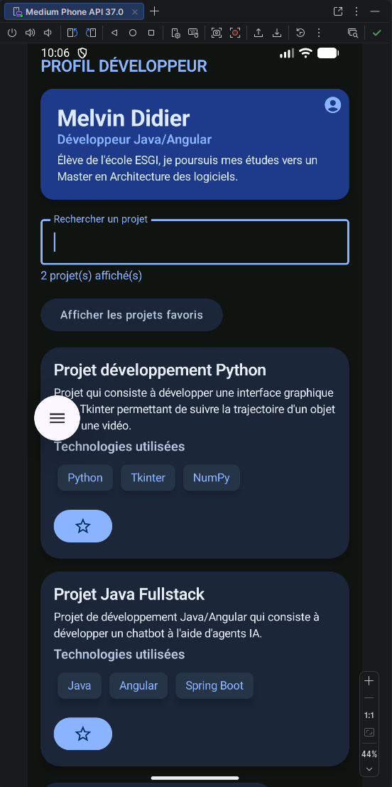

# Profil Compose Interactif

## Présentation
---
Cette application Android affiche un écran de profil réalisé avec Jetpack Compose.
 
Le profil principal présente Melvin Didier qui est développeur Java/Angular, sa description,
et ses projets personnels avec les technologies utilisées.
 
Une recherche de projets via une barre de recherche est maintenant possible. L'utilisateur peut
aussi ajouter un projet à ses projets favoris. Enfin, la zone de contact qui est initialement
masquée peut être affichée à l'aide d'un bouton.

## États gérés par l'application
---
- Texte de recherche : permet d'affiche les projets dont le titre ou une des technologies utilisées
correspond à la recherche. Si le filtre favori est activé, la recherche est appliquée uniquement aux
projets favoris.
- Filtre favori : permet d'afficher les projets favoris.
- Projets favoris : l'ajout d'un projet à la liste des favoris.
- Liste affichée : la liste des projets qui varie selon les favoris ou la recherche.

## État local
---
` Quel état avez-vous conservé directement dans un composable et pourquoi ? `
J'ai conservé l'état d'affichage des informations de contact dans un composable, car il ne concerne
pas les données métier de l'application et n'a pas besoin d'être partagé avec d'autres composables.

## State Hoisting
---
`Pourquoi votre composable d'écran principal peut-il être considéré comme stateless ?`
Le composant d'écran principal n'est pas considéré comme stateless car il ne gère aucun état.
En effet, il reçoit les valeurs et les callbacks donnés en paramètre.

## View Model
---
`Quel est le rôle de votre ViewModel dans cette application ?`
Dans mon application, le ViewModel permet de gérer les données et la logique métier.
Il gère la liste des projets, la recherche, les favoris et les filtres. De plus, il traite les
actions utilisateur et met à jour l'état en conséquence.

## State Flow
---
`Comment l'interface est-elle informée lorsqu'un état change ?`
L'interface est informée grâce à un StateFlow. Le ViewModel possède un MutableStateFlow qui contient
l'état actuel de l'écran et sa valeur est mis eà jour avec update().
Dans le composable, collectAsState() permet d'observer ce StateFlow et de récupérer sa valeur
via uiState qui ets public.

## Organisation du code
---
- ProfileViewModel : gère la liste de projets, la recherche, les favoris et les filtres.
- ProfileUiState : data class qui regroupe les informations nécessaires à l'affichage.
- ProfileContainer : récupère les données du ViewModel et transmet les informations nécessaires à
l'interface.
- ProfileScreen : l'écran affiché qui contient tous les éléments.
- ProjectCard : affiche les informations d'un projet.

## Photo
---

