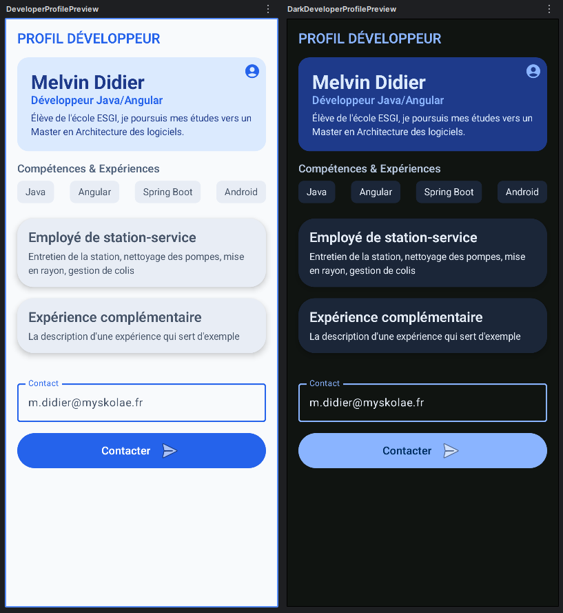

# Profil Compose

## Présentation

Cette application Android affiche un écran de profil réalisé avec Jetpack Compose.
Le profil principal présente Melvin Didier qui est développeur Java/Angular, sa description,
ses compétences et expériences professionnelles et son email.
Le bouton « Contacter » (qui ne fait rien) représente une action utilisateur.

## Composants utilisés

- Text
- Button
- Icon
- Image
- Card
- OutlinedTextField

## Layouts Compose utilisés
- Column
- Row
- Box
- Spacer
- Surface

## Listes modernes
LazyColumn est utilisé pour la mise en page. Elle permet d'afficher chaque élément et contient une
section items qui affiche les expériences en suivant leur id.

## Thèmes
J'ai principalement choisi du bleu, les nuances varient selon la couleur du thème système.
J'ai défini des formes (PShapes) afin de personnaliser la forme de mes composants Card et Surface.
J'ai aussi défini PTypography qui me permet de personnaliser la taille du texte. 

## Photo

